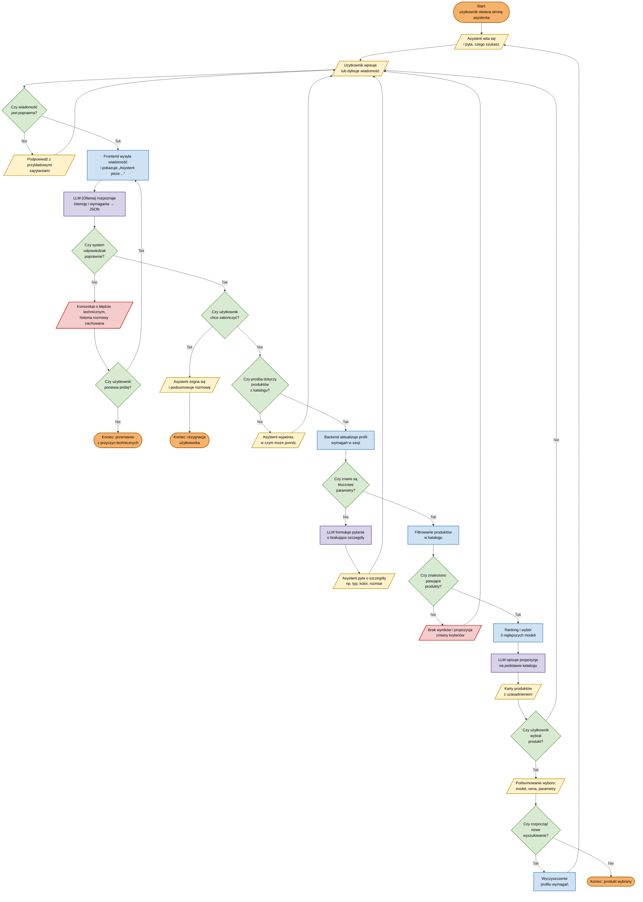
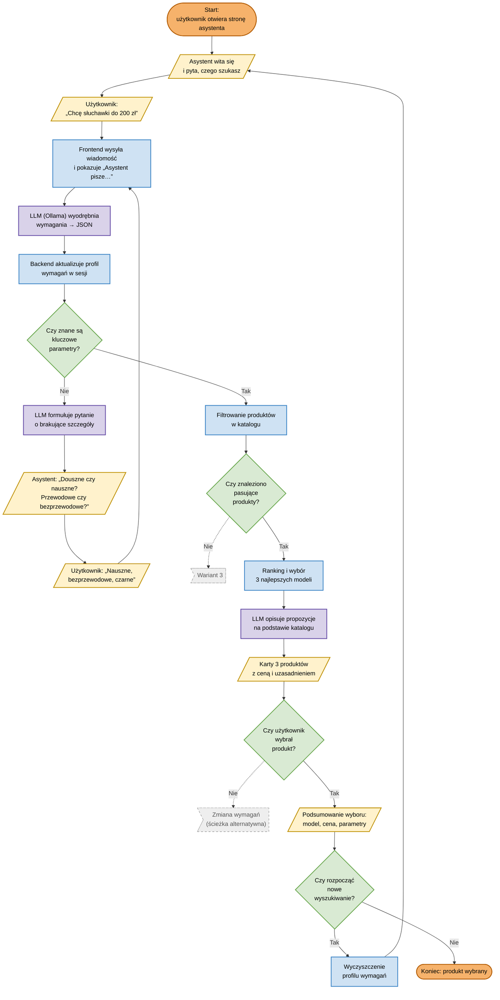
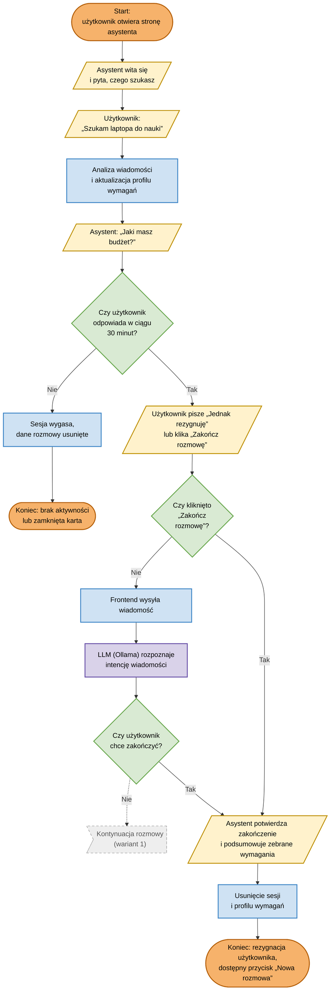
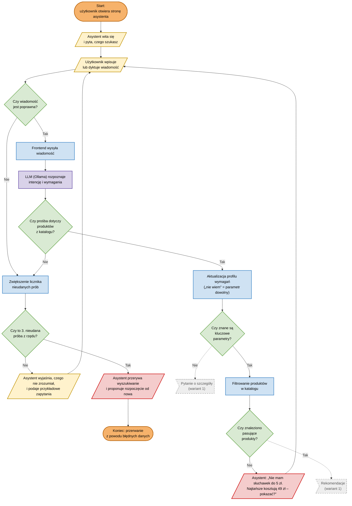
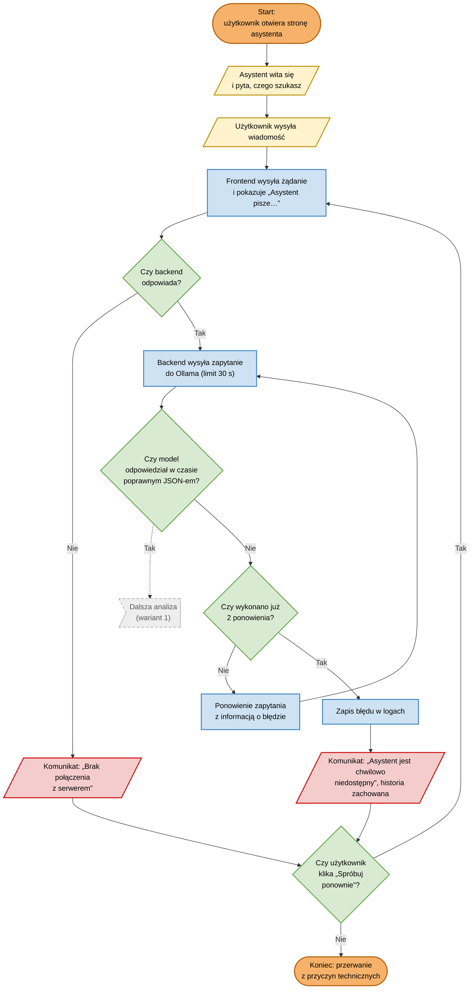

# Asystent Zakupowy

Konwersacyjny asystent zakupowy działający na lokalnym modelu językowym uruchomionym w [Ollama](https://ollama.com). Użytkownik opisuje w czacie (tekstem lub głosem), czego szuka, asystent dopytuje o brakujące szczegóły, a następnie proponuje konkretne modele z katalogu, które spełniają podane wymagania.

Przykładowa rozmowa:

> **Użytkownik:** Chcę słuchawki do 200 zł.
> **Asystent:** Jasne! Wolisz słuchawki douszne czy nauszne? I czy mają być bezprzewodowe?
> **Użytkownik:** Nauszne, bezprzewodowe, najlepiej czarne.
> **Asystent:** Mam trzy propozycje w Twoim budżecie: … *(karty produktów z ceną i krótkim uzasadnieniem)*

## Schemat blokowy interakcji użytkownika z systemem

Poniżej znajduje się schemat ogólny, który obejmuje wszystkie ścieżki interakcji, a dalej cztery warianty jej przebiegu. Wersje PNG i źródła Mermaid wszystkich schematów są w katalogu [`docs/`](docs/).

### Elementy schematów

| Symbol | Znaczenie | Przykłady |
|---|---|---|
| Owal (pomarańczowy) | Start / Koniec | otwarcie strony, wybór produktu, rezygnacja, przerwanie techniczne |
| Prostokąt (niebieski) | Proces wykonywany przez system | wysłanie wiadomości, aktualizacja sesji, filtrowanie, ranking |
| Prostokąt (fioletowy) | Proces wykonywany przez model językowy w Ollama | rozpoznanie intencji i wymagań, sformułowanie pytania, opis propozycji |
| Równoległobok (żółty) | Wejście / Wyjście | wiadomości użytkownika, pytania i odpowiedzi asystenta |
| Równoległobok (czerwony) | Wyjście sygnalizujące problem | brak wyników, błąd techniczny, przerwanie wyszukiwania |
| Romb (zielony) | Decyzja ze ścieżkami „Tak” / „Nie” | komplet parametrów, znalezienie produktów, akceptacja propozycji |
| Strzałka ciągła | Kolejność operacji i kierunek przepływu informacji | |
| Szara flaga i strzałka przerywana | Przejście do innego wariantu, opisanego na osobnym schemacie | „Rekomendacje (wariant 1)” |

### Schemat ogólny



[Wersja PNG](docs/schemat-blokowy.png)

### Opis przebiegu

1. **Rozpoczęcie interakcji.** Użytkownik otwiera stronę asystenta w przeglądarce. System tworzy nową sesję, a asystent wita się i pyta, czego użytkownik szuka.
2. **Dane wejściowe.** Użytkownik wpisuje wiadomość lub dyktuje ją po kliknięciu przycisku mikrofonu. Przekazuje w ten sposób rodzaj produktu, budżet, preferencje (np. typ, kolor, rozmiar) oraz odpowiedzi na pytania asystenta. Poza tym steruje rozmową przyciskami: „Wybieram” przy produkcie, „Zakończ rozmowę”, „Nowa rozmowa” i „Spróbuj ponownie”.
3. **Przetwarzanie danych.** Kolejne operacje to: sprawdzenie wiadomości we frontendzie, przesłanie jej do backendu, rozpoznanie intencji i wymagań przez model w Ollama (odpowiedź w formacie JSON sprawdzana przez Pydantic), aktualizacja profilu wymagań w sesji, filtrowanie katalogu, ranking i wybór 3 najlepszych modeli, a na końcu opis propozycji przez model wyłącznie na podstawie danych z katalogu.
4. **Warunki decyzyjne.**

   | Decyzja | „Tak” | „Nie” |
   |---|---|---|
   | Czy wiadomość jest poprawna? (niepusta, do 500 znaków, mowa rozpoznana) | wysłanie do backendu | podpowiedź i ponowne wpisanie (wariant 3) |
   | Czy system odpowiedział poprawnie? | dalsza analiza | komunikat o błędzie technicznym (wariant 4) |
   | Czy użytkownik ponawia próbę? | ponowne wysłanie tej samej wiadomości | koniec z przyczyn technicznych |
   | Czy użytkownik chce zakończyć? | pożegnanie i podsumowanie (wariant 2) | dalsza analiza |
   | Czy prośba dotyczy produktów z katalogu? | aktualizacja profilu wymagań | wyjaśnienie, w czym asystent może pomóc (wariant 3) |
   | Czy znane są kluczowe parametry? | wyszukiwanie produktów | pytanie o brakujące szczegóły |
   | Czy znaleziono pasujące produkty? | ranking i rekomendacje | propozycja złagodzenia kryteriów |
   | Czy użytkownik wybrał produkt? | podsumowanie wyboru | zmiana wymagań i dalsza rozmowa |
   | Czy rozpocząć nowe wyszukiwanie? | wyczyszczenie profilu i nowe powitanie | koniec z wybranym produktem |

5. **Informacja zwrotna.** Użytkownik przez cały czas widzi stan systemu:
   - wskaźnik „Asystent pisze…” podczas przetwarzania, a przy dyktowaniu sygnalizację nasłuchiwania mikrofonu;
   - panel „Twoje wymagania” z aktualnym profilem (np. kategoria: słuchawki, budżet: do 200 zł, typ: ?), dzięki któremu widać, co asystent już zrozumiał i o co jeszcze zapyta;
   - pytania asystenta, karty produktów z uzasadnieniem oraz podsumowanie wyboru;
   - komunikaty o niezrozumiałej wiadomości, braku wyników lub błędzie technicznym, zawsze z informacją, co można zrobić dalej.
6. **Zakończenie interakcji.** Rozmowa kończy się na jeden z trzech sposobów: wyborem produktu (wynikiem jest podsumowanie z modelem, ceną i parametrami), rezygnacją użytkownika albo przerwaniem z przyczyn technicznych. Po wyborze produktu asystent sam proponuje nowe wyszukiwanie, a w pozostałych przypadkach proces można rozpocząć ponownie przyciskiem „Nowa rozmowa” lub „Spróbuj ponownie”.

## Walidacja i scenariusze skrajne

### Obsługa błędów

| Miejsce | Możliwy problem | Reakcja systemu |
|---|---|---|
| Frontend | pusta lub zbyt długa wiadomość, nierozpoznana mowa, brak zgody na mikrofon | wiadomość nie jest wysyłana; podpowiedź i możliwość wpisania tekstu |
| Połączenie frontend ↔ backend | serwer nie działa, brak sieci, przekroczony czas odpowiedzi | komunikat „Brak połączenia z serwerem”, wpisana wiadomość nie znika, przycisk „Spróbuj ponownie” |
| Połączenie backend ↔ Ollama | Ollama nie jest uruchomiona, model nie jest pobrany, odpowiedź trwa ponad 30 s | do 2 ponowień, następnie zapis w logach i komunikat o chwilowej niedostępności |
| Odpowiedź modelu | niepoprawny JSON, nieistniejąca kategoria lub wartość | walidacja Pydantic i ponowienie zapytania z opisem błędu; nieznane wartości są odrzucane |
| Wyszukiwanie | brak produktów spełniających kryteria | pokazanie najbliższej dostępnej opcji i propozycja złagodzenia kryteriów |
| Sesja | brak aktywności przez 30 minut lub zamknięcie karty | sesja wygasa, dane rozmowy są usuwane |

### Alternatywne ścieżki

- **Prośba spoza zakresu** („Jaka jutro pogoda?”, „Szukam lodówki”): asystent wyjaśnia, w jakich kategoriach może pomóc. Po trzeciej nieudanej próbie z rzędu przerywa wyszukiwanie i proponuje rozpoczęcie od nowa. Licznik zeruje się po każdej poprawnej wiadomości (wariant 3).
- **Odpowiedź „nie wiem” lub „obojętnie”**: parametr zostaje oznaczony jako dowolny i asystent nie pyta o niego ponownie.
- **Zbyt wiele pytań**: po trzech dopytaniach asystent przedstawia propozycje na podstawie tego, co już wie, zamiast pytać dalej.
- **Zmiana zdania w trakcie rozmowy** („jednak do 300 zł”, „a coś tańszego?”): nowa informacja nadpisuje wcześniejszą w profilu wymagań i wyszukiwanie odbywa się ponownie.
- **Rezygnacja** słowami lub przyciskiem „Zakończ rozmowę” (wariant 2).

## Warianty przebiegu interakcji

Każdy wariant pokazuje jedną ścieżkę przez system. Gałęzie prowadzące do innych wariantów są oznaczone szarą flagą i strzałką przerywaną.

### Wariant 1: przebieg prawidłowy

Użytkownik szuka słuchawek, odpowiada na jedno pytanie i wybiera jedną z proponowanych opcji.

1. Użytkownik otwiera stronę, a asystent się wita.
2. Użytkownik pisze „Chcę słuchawki do 200 zł”. Model rozpoznaje kategorię i budżet, ale brakuje typu słuchawek i rodzaju łączności.
3. Asystent pyta: „Douszne czy nauszne? Przewodowe czy bezprzewodowe?”, a użytkownik odpowiada: „Nauszne, bezprzewodowe, czarne”.
4. Profil wymagań jest kompletny, więc system filtruje katalog i wybiera 3 najlepsze modele, które model językowy opisuje na podstawie danych z katalogu.
5. Użytkownik klika „Wybieram” przy jednym z produktów i otrzymuje podsumowanie: model, cenę i najważniejsze parametry.
6. Asystent pyta, czy rozpocząć nowe wyszukiwanie. Użytkownik odmawia i interakcja kończy się sukcesem.

Sprawdzenie poprawności wiadomości i odpowiedzi modelu kończy się w tym wariancie wynikiem pozytywnym, dlatego dla czytelności pominięto je na schemacie (pełna wersja: schemat ogólny).



[Wersja PNG](docs/wariant-1-prawidlowy.png)

### Wariant 2: przerwanie przez użytkownika – świadome zakończenie

Użytkownik rozpoczyna rozmowę, ale w jej trakcie rezygnuje.

1. Użytkownik pisze „Szukam laptopa do nauki”, a asystent pyta o budżet.
2. Użytkownik może zakończyć rozmowę na trzy sposoby:
   - kliknąć „Zakończ rozmowę”, co kończy rozmowę od razu, bez analizy przez model;
   - napisać np. „Jednak rezygnuję” lub „Dziękuję, to wszystko”, a model rozpozna intencję zakończenia;
   - nie odpowiadać lub zamknąć kartę, a wtedy po 30 minutach bez aktywności sesja wygasa.
3. W dwóch pierwszych przypadkach asystent potwierdza zakończenie i podsumowuje zebrane dotąd wymagania, a następnie sesja jest usuwana.
4. Przycisk „Nowa rozmowa” pozwala rozpocząć proces od nowa.



[Wersja PNG](docs/wariant-2-rezygnacja.png)

### Wariant 3: przerwanie przez użytkownika – nieprawidłowe dane lub nieoczekiwane działanie

Użytkownik wysyła wiadomości, których system nie może obsłużyć w zwykły sposób.

1. **Niepoprawna wiadomość** (pusta, dłuższa niż 500 znaków, nierozpoznana mowa): frontend jej nie wysyła.
2. **Prośba spoza zakresu** („Jaka jutro pogoda?”, „Szukam lodówki”): model rozpoznaje, że nie dotyczy ona produktów z katalogu.
3. W obu przypadkach system zwiększa licznik nieudanych prób. Przy pierwszej i drugiej próbie asystent wyjaśnia, czego nie zrozumiał, i podaje przykładowe zapytania. Przy trzeciej próbie z rzędu przerywa wyszukiwanie i proponuje rozpoczęcie od nowa.
4. **Nierealne wymagania** („słuchawki do 5 zł”): wiadomość jest poprawna, ale filtrowanie nie zwraca wyników, więc asystent pokazuje najbliższą dostępną opcję i proponuje zmianę kryteriów.
5. **Odpowiedź „nie wiem”**: parametr zostaje oznaczony jako dowolny, więc rozmowa nie utyka na tym samym pytaniu.

Gdy użytkownik poprawi wiadomość, rozmowa wraca na ścieżkę z wariantu 1.



[Wersja PNG](docs/wariant-3-bledne-dane.png)

### Wariant 4: błąd systemu

Przetwarzanie zostaje przerwane z przyczyn technicznych.

1. Użytkownik wysyła wiadomość, a frontend pokazuje „Asystent pisze…”.
2. **Backend nie odpowiada** (serwer wyłączony, brak sieci): frontend pokazuje komunikat „Brak połączenia z serwerem”.
3. **Ollama nie odpowiada lub zwraca błędne dane** (usługa nie jest uruchomiona, model nie jest pobrany, przekroczony limit 30 s, niepoprawny JSON): backend ponawia zapytanie do 2 razy, dołączając opis błędu. Jeśli to nie pomoże, zapisuje błąd w logach, a użytkownik widzi komunikat „Asystent jest chwilowo niedostępny”.
4. W obu przypadkach historia rozmowy i profil wymagań zostają zachowane. Użytkownik może kliknąć „Spróbuj ponownie”, aby wysłać tę samą wiadomość jeszcze raz, albo zrezygnować, co kończy interakcję.



[Wersja PNG](docs/wariant-4-blad-systemu.png)

## Architektura i technologie

| Warstwa | Technologia | Rola |
|---|---|---|
| Model językowy | Ollama + `qwen2.5:7b` (model ustawiany w `.env`; słabsze komputery: `llama3.2:3b`; dla lepszego polskiego warto sprawdzić Bielika od SpeakLeash) | rozmowa, rozpoznawanie intencji i wymagań, opis propozycji |
| Backend | Python 3.11+, FastAPI, Pydantic, biblioteka `ollama` | API, stan sesji, walidacja JSON, obsługa błędów |
| Dane | `products.json`, `categories.json` | katalog produktów i wymagane parametry każdej kategorii |
| Rekomendacje | własny moduł w Pythonie | filtrowanie, punktacja, wybór top 3 |
| Frontend | HTML, CSS, JavaScript (bez frameworka), serwowany przez FastAPI | okno czatu, karty produktów, panel wymagań |
| Głos (opcjonalnie) | Web Speech API w przeglądarce | dyktowanie zapytań i odczyt odpowiedzi |
| Testy | pytest | testy rekomendera i jakości rozpoznawania wymagań |

**Zasada projektu: model rozmawia, kod liczy.** Model językowy nie wybiera produktów i nie zna cen z pamięci, bo mógłby je wymyślić. Jego zadania to zrozumienie wypowiedzi, zadawanie pytań i opisanie gotowych wyników. Produkty wybiera deterministyczny kod na podstawie katalogu, dzięki czemu każda rekomendacja jest prawdziwa i powtarzalna.

Rozpoznawanie wymagań korzysta z trybu structured outputs w Ollama: do zapytania przekazywany jest schemat JSON (`format=Requirements.model_json_schema()`), a odpowiedź jest walidowana przez Pydantic.

### Kontrakt API (wspólny dla obu osób)

Ustalony na początku, żeby frontend i backend mogły powstawać równolegle (frontend na początku korzysta z przykładowej odpowiedzi zapisanej na sztywno).

`POST /api/chat`

```json
{ "session_id": "a1b2c3", "message": "Chcę słuchawki do 200 zł" }
```

Odpowiedź:

```json
{
  "reply": "Wolisz słuchawki douszne czy nauszne?",
  "state": "asking",
  "requirements": {
    "category": "sluchawki",
    "budget_max": 200,
    "attributes": { "typ": null, "lacznosc": null, "kolor": null }
  },
  "products": []
}
```

Pole `state` przyjmuje wartości:

- `asking`: asystent dopytuje o szczegóły,
- `recommending`: w `products` są propozycje (pola `id`, `name`, `price`, `attributes`, `reason`),
- `no_results`: brak pasujących produktów,
- `out_of_scope`: wiadomość spoza zakresu lub niezrozumiała,
- `selected`: użytkownik wybrał produkt,
- `ended`: rozmowa zakończona.

Wybór produktu to to samo żądanie z polem `selected_product_id` zamiast `message`. Przycisk „Zakończ rozmowę” wywołuje `DELETE /api/session/{session_id}`. Gdy Ollama nie odpowiada mimo ponowień, backend zwraca HTTP 503 z treścią `{"error": "llm_unavailable"}`.

### Planowana struktura repozytorium

```
asystent-zakupowy/
├── README.md
├── docs/                    schematy blokowe (PNG + źródła Mermaid)
├── backend/
│   ├── app/
│   │   ├── main.py          endpointy FastAPI                     (A)
│   │   ├── llm.py           klient Ollama i prompty                (A)
│   │   ├── dialog.py        menedżer rozmowy i stan sesji          (A)
│   │   ├── recommender.py   filtrowanie i ranking                  (B)
│   │   └── schemas.py       modele Pydantic                    (A + B)
│   ├── data/
│   │   ├── products.json                                           (B)
│   │   └── categories.json                                         (B)
│   ├── tests/                                                  (A + B)
│   └── requirements.txt
└── frontend/
    ├── index.html                                                  (B)
    ├── app.js                                                      (B)
    └── style.css                                                   (B)
```

Każda osoba pracuje głównie we „własnych” plikach, więc konflikty przy scalaniu są rzadkie.

## Plan prac i podział zadań

### Etap 0: wspólnie

- [x] README ze schematem blokowym interakcji
- [x] Obsługa błędów, scenariusze skrajne i cztery warianty przebiegu interakcji
- [ ] Uzgodnienie kontraktu API i modeli danych w `schemas.py` (`Requirements`, `Product`, `ChatRequest`, `ChatResponse`)
- [ ] Wybór trzech kategorii produktów i ich kluczowych parametrów (propozycja: słuchawki, buty sportowe, laptopy)

### Etap 1–2: równolegle

| | Osoba A: mózg asystenta (LLM, dialog, API) | Osoba B: dane i interfejs (katalog, rekomendacje, frontend) |
|---|---|---|
| 1 | Szkielet backendu: FastAPI, `/health`, konfiguracja `.env` (adres Ollama, nazwa modelu), `requirements.txt` | Katalog `products.json` (3 kategorie × ok. 20 produktów) i `categories.json` (parametry wymagane i opcjonalne) |
| 2 | Klient Ollama i prompt systemowy, rozpoznawanie intencji i wymagań do JSON z walidacją, limitem czasu 30 s i maks. 2 ponowieniami | Rekomender: filtry twarde, punktacja preferencji, wybór top 3, najbliższa opcja i łagodzenie kryteriów przy braku wyników |
| 3 | Menedżer dialogu: stan sesji, brakujące parametry, limit 3 dopytań, „nie wiem” jako parametr dowolny, licznik nieudanych prób, wygasanie sesji | Testy pytest rekomendera |
| 4 | Endpointy `POST /api/chat` i `DELETE /api/session/{id}`, odpowiedź 503 przy awarii Ollama (na początku z atrapą rekomendera) | Frontend: okno czatu, karty produktów z przyciskiem „Wybieram”, panel „Twoje wymagania”, wskaźnik „Asystent pisze…” (na początku z atrapą API) |
| 5 | Opis rekomendacji przez model wyłącznie na podstawie danych z katalogu, podsumowanie wyboru i pożegnanie | Walidacja wiadomości, komunikaty błędów, przyciski „Zakończ rozmowę”, „Nowa rozmowa”, „Spróbuj ponownie”; opcjonalnie głos przez Web Speech API (`pl-PL`) |
| 6 | Zestaw ok. 20 przykładowych wypowiedzi z oczekiwanymi wymaganiami, porównanie dwóch modeli | Instrukcja uruchomienia i scenariusze demonstracyjne odpowiadające czterem wariantom |

### Etap 3: wspólnie

- [ ] Integracja frontendu z API i przejście wszystkich czterech wariantów na działającej aplikacji
- [ ] Dopracowanie promptów na podstawie testów
- [ ] Przygotowanie prezentacji i demonstracji

### Zasady pracy z repozytorium

- Gałąź `main` zawiera tylko działający kod; każde zadanie powstaje na osobnej gałęzi `feature/<nazwa>`.
- Zmiany trafiają do `main` przez pull request, który przegląda druga osoba.
- Zadania z tabeli są prowadzone jako GitHub Issues oznaczone etykietą `osoba-a` lub `osoba-b`.

## Uruchomienie (w przygotowaniu)

```bash
ollama pull qwen2.5:7b
cd backend
pip install -r requirements.txt
uvicorn app.main:app --reload
```

Następnie otwórz `http://localhost:8000` w przeglądarce.
