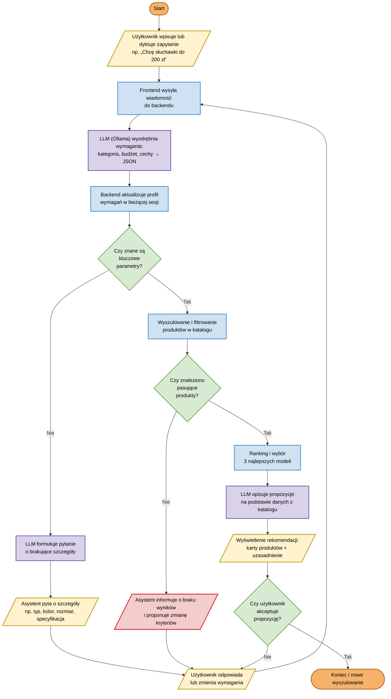

# Asystent Zakupowy

Konwersacyjny asystent zakupowy działający na lokalnym modelu językowym uruchomionym w [Ollama](https://ollama.com). Użytkownik opisuje w czacie (tekstem lub głosem), czego szuka, asystent dopytuje o brakujące szczegóły, a następnie proponuje konkretne modele z katalogu, które spełniają podane wymagania.

Przykładowa rozmowa:

> **Użytkownik:** Chcę słuchawki do 200 zł.
> **Asystent:** Jasne! Wolisz słuchawki douszne czy nauszne? I czy mają być bezprzewodowe?
> **Użytkownik:** Nauszne, bezprzewodowe, najlepiej czarne.
> **Asystent:** Mam trzy propozycje w Twoim budżecie: … *(karty produktów z ceną i krótkim uzasadnieniem)*

## Schemat blokowy interakcji użytkownika z systemem

Schemat przedstawia cały proces: od zapytania użytkownika, przez dopytywanie o szczegóły i wyszukiwanie produktów, aż do przedstawienia rekomendacji i zakończenia rozmowy. Wersja graficzna: [`docs/schemat-blokowy.png`](docs/schemat-blokowy.png), źródło: [`docs/schemat-blokowy.mmd`](docs/schemat-blokowy.mmd).



### Elementy schematu

| Kształt | Znaczenie | W naszym schemacie |
|---|---|---|
| Owal (pomarańczowy) | Start / Koniec | rozpoczęcie rozmowy, zakończenie lub nowe wyszukiwanie |
| Prostokąt (niebieski) | Proces wykonywany przez system | wysłanie wiadomości, aktualizacja sesji, filtrowanie, ranking |
| Prostokąt (fioletowy) | Proces wykonywany przez model językowy w Ollama | wyodrębnienie wymagań, sformułowanie pytania, opis propozycji |
| Równoległobok (żółty / czerwony) | Wejście / Wyjście | zapytanie i odpowiedzi użytkownika, pytania asystenta, rekomendacje; czerwony oznacza komunikat o braku wyników |
| Romb (zielony) | Decyzja z dwiema ścieżkami „Tak” / „Nie” | komplet parametrów, znalezienie produktów, akceptacja propozycji |
| Strzałki | Kolejność operacji i kierunek przepływu informacji | |

### Przebieg interakcji

1. Użytkownik wpisuje lub dyktuje zapytanie, a frontend przesyła je do backendu.
2. Model językowy w Ollama zamienia swobodną wypowiedź na ustrukturyzowane wymagania w formacie JSON (kategoria, budżet, cechy). Backend sprawdza poprawność odpowiedzi i w razie błędu ponawia zapytanie, a następnie łączy nowe informacje z tym, co już wiadomo z wcześniejszej części rozmowy.
3. **Decyzja 1:** jeżeli brakuje kluczowych parametrów danej kategorii (np. dla słuchawek: typ i łączność), asystent zadaje pytanie o brakujące szczegóły i czeka na odpowiedź. Liczba dopytań jest ograniczona, aby rozmowa nie zamieniła się w przesłuchanie.
4. Gdy wymagania są kompletne, system filtruje katalog produktów według twardych kryteriów (kategoria, budżet, wymagane cechy).
5. **Decyzja 2:** jeżeli nic nie pasuje, asystent informuje o tym i proponuje złagodzenie kryteriów (np. podniesienie budżetu lub rezygnację z koloru).
6. Pasujące produkty są oceniane według preferencji użytkownika, a trzy najlepsze trafiają do modelu, który opisuje je wyłącznie na podstawie danych z katalogu.
7. Rekomendacje są wyświetlane jako karty produktów z uzasadnieniem.
8. **Decyzja 3:** jeżeli użytkownik chce coś zmienić („a coś tańszego?”), rozmowa wraca do kroku 1 z zachowaniem dotychczasowych wymagań. W przeciwnym razie rozmowa się kończy lub zaczyna się nowe wyszukiwanie.

## Architektura i technologie

| Warstwa | Technologia | Rola |
|---|---|---|
| Model językowy | Ollama + `qwen2.5:7b` (model ustawiany w `.env`; słabsze komputery: `llama3.2:3b`; dla lepszego polskiego warto sprawdzić Bielika od SpeakLeash) | rozmowa, wyodrębnianie wymagań, opis propozycji |
| Backend | Python 3.11+, FastAPI, Pydantic, biblioteka `ollama` | API, stan sesji, walidacja JSON |
| Dane | `products.json`, `categories.json` | katalog produktów i wymagane parametry każdej kategorii |
| Rekomendacje | własny moduł w Pythonie | filtrowanie, punktacja, wybór top 3 |
| Frontend | HTML, CSS, JavaScript (bez frameworka), serwowany przez FastAPI | okno czatu, karty produktów |
| Głos (opcjonalnie) | Web Speech API w przeglądarce | dyktowanie zapytań i odczyt odpowiedzi |
| Testy | pytest | testy rekomendera i jakości wyodrębniania wymagań |

**Zasada projektu: model rozmawia, kod liczy.** Model językowy nie wybiera produktów i nie zna cen z pamięci, bo mógłby je wymyślić. Jego zadania to zrozumienie wypowiedzi, zadawanie pytań i opisanie gotowych wyników. Produkty wybiera deterministyczny kod na podstawie katalogu, dzięki czemu każda rekomendacja jest prawdziwa i powtarzalna.

Wyodrębnianie wymagań korzysta z trybu structured outputs w Ollama: do zapytania przekazywany jest schemat JSON (`format=Requirements.model_json_schema()`), a odpowiedź jest walidowana przez Pydantic.

### Kontrakt API (wspólny dla obu osób)

Ustalony na początku, żeby frontend i backend mogły powstawać równolegle (frontend na początku korzysta z przykładowej odpowiedzi zapisanej na sztywno).

`POST /api/chat`

```json
{ "session_id": "a1b2c3", "message": "Chcę słuchawki do 200 zł" }
```

Odpowiedź:

```json
{
  "reply": "Wolisz słuchawki douszne czy nauszne?",
  "state": "asking",
  "requirements": {
    "category": "sluchawki",
    "budget_max": 200,
    "attributes": { "typ": null, "lacznosc": null, "kolor": null }
  },
  "products": []
}
```

Pole `state` przyjmuje wartości `asking` (asystent dopytuje), `recommending` (w `products` są propozycje) lub `no_results` (brak pasujących produktów). Każdy produkt w `products` ma pola `id`, `name`, `price`, `attributes` i `reason`.

### Planowana struktura repozytorium

```
asystent-zakupowy/
├── README.md
├── docs/                    schemat blokowy (PNG + źródło Mermaid)
├── backend/
│   ├── app/
│   │   ├── main.py          endpointy FastAPI                     (A)
│   │   ├── llm.py           klient Ollama i prompty                (A)
│   │   ├── dialog.py        menedżer rozmowy i stan sesji          (A)
│   │   ├── recommender.py   filtrowanie i ranking                  (B)
│   │   └── schemas.py       modele Pydantic                    (A + B)
│   ├── data/
│   │   ├── products.json                                           (B)
│   │   └── categories.json                                         (B)
│   ├── tests/                                                  (A + B)
│   └── requirements.txt
└── frontend/
    ├── index.html                                                  (B)
    ├── app.js                                                      (B)
    └── style.css                                                   (B)
```

Każda osoba pracuje głównie we „własnych” plikach, więc konflikty przy scalaniu są rzadkie.

## Plan prac i podział zadań

### Etap 0: wspólnie

- [x] README ze schematem blokowym interakcji
- [ ] Uzgodnienie kontraktu API i modeli danych w `schemas.py` (`Requirements`, `Product`, `ChatRequest`, `ChatResponse`)
- [ ] Wybór trzech kategorii produktów i ich kluczowych parametrów (propozycja: słuchawki, buty sportowe, laptopy)

### Etap 1–2: równolegle

| | Osoba A: mózg asystenta (LLM, dialog, API) | Osoba B: dane i interfejs (katalog, rekomendacje, frontend) |
|---|---|---|
| 1 | Szkielet backendu: FastAPI, `/health`, konfiguracja `.env` (adres Ollama, nazwa modelu), `requirements.txt` | Katalog `products.json` (3 kategorie × ok. 20 produktów) i `categories.json` (parametry wymagane i opcjonalne) |
| 2 | Klient Ollama i prompt systemowy, wyodrębnianie wymagań do JSON z walidacją i ponowieniem przy błędzie | Rekomender: filtry twarde, punktacja preferencji, wybór top 3, łagodzenie kryteriów przy braku wyników |
| 3 | Menedżer dialogu: stan sesji, wykrywanie brakujących parametrów, limit dopytań, generowanie pytań | Testy pytest rekomendera |
| 4 | Endpoint `POST /api/chat` łączący dialog z rekomenderem (na początku z atrapą rekomendera) | Frontend: okno czatu, karty produktów, wskaźnik „asystent pisze…”, obsługa błędów (na początku z atrapą API) |
| 5 | Opis rekomendacji przez model wyłącznie na podstawie danych z katalogu | Wejście i wyjście głosowe przez Web Speech API (`pl-PL`) |
| 6 | Zestaw ok. 20 przykładowych wypowiedzi z oczekiwanymi wymaganiami, porównanie dwóch modeli | Instrukcja uruchomienia i scenariusze demonstracyjne |

### Etap 3: wspólnie

- [ ] Integracja frontendu z `/api/chat` i testy pełnych scenariuszy rozmowy
- [ ] Dopracowanie promptów na podstawie testów
- [ ] Przygotowanie prezentacji i demonstracji

### Zasady pracy z repozytorium

- Gałąź `main` zawiera tylko działający kod; każde zadanie powstaje na osobnej gałęzi `feature/<nazwa>`.
- Zmiany trafiają do `main` przez pull request, który przegląda druga osoba.
- Zadania z tabeli są prowadzone jako GitHub Issues oznaczone etykietą `osoba-a` lub `osoba-b`.

## Uruchomienie (w przygotowaniu)

```bash
ollama pull qwen2.5:7b
cd backend
pip install -r requirements.txt
uvicorn app.main:app --reload
```

Następnie otwórz `http://localhost:8000` w przeglądarce.
